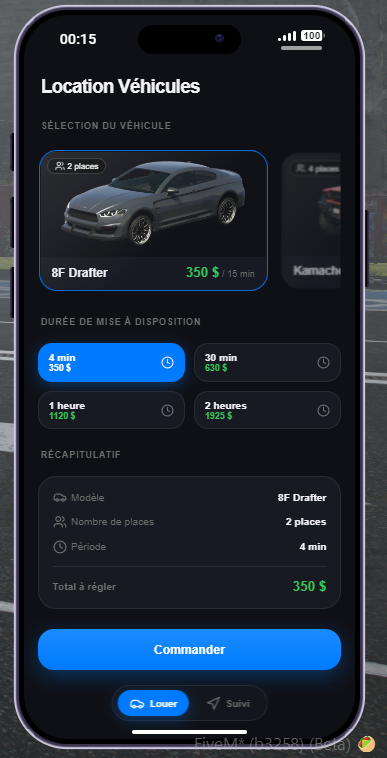
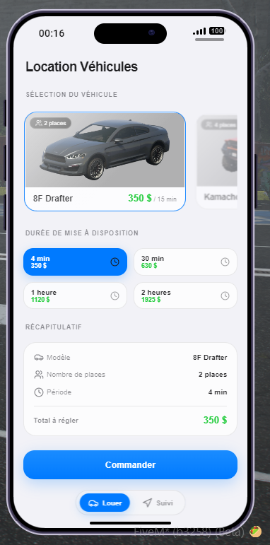

# 🚗 old_rentVehicle

A sleek, responsive, and immersive vehicle rental application for FiveM built for **LB Phone**, powered by **ESX Legacy**.

Deliver vehicles right to your players using automated NPC couriers, live in-app GPS tracking, and advanced anti-theft security using server-synced State Bags.


---

## 📸 Previews
<p align="center">
  
  
</p>
---

## ✨ Features

* **📱 Native LB Phone Custom App**: Modern iOS Glassmorphism UI built with React & Lucide Icons, fully reactive to both Dark and Light system phone themes.
* **🤖 Autonomous NPC Delivery**: Spawns a driver NPC on the nearest valid roadway who dynamically drives to the player's exact live location, parks, exits, and unlocks the vehicle.
* **🗺️ Live Interactive In-App Map**: Built with Leaflet using custom high-resolution GTA V Atlas tiles, featuring real-time live vehicle and player positioning.
* **📍 Dynamic GTA Radar GPS**: Automatically sets a destination blip with route tracing on the player's minimap during vehicle transit.
* **⏱️ Smart Timer & Extension**:
* The rental countdown starts only once the ordering player takes the driver's seat.
* Automatic warning notification and danger countdown display when less than 3 minutes remain.
* In-app 1-click rental extension button with dynamic pricing.


* **🔒 Anti-Theft & State Bag Security**:
* Utilizes replicated server-side State Bags (`Entity(veh).state.rentPhoneNumber`).
* Only the exact phone number used to order the rental is authorized to start the engine and drive.
* Attempted theft or unauthorized driving automatically cuts the engine, makes the car undriveable, and ejects the intruder.
* The vehicle and courier remain invulnerable and locked against hijackers during delivery.


* **⏳ Abandonment Safeguard**: Automatically recalls and deletes the vehicle if the client fails to claim it within 5 minutes of arrival.
* **💳 Banking Integration**: Automatic payment processing with native **lb-phone** banking transaction logs.

---

## 📦 Requirements

* [`es_extended`](https://github.com/esx-framework/esx_core) (ESX Legacy)
* [`lb-phone`](https://lbphone.com/)

---

## 🛠️ Installation

1. Clone or download this repository into your FiveM server's `resources` directory:
```bash
git clone [https://github.com/YourUsername/old_rentVehicle.git](https://github.com/YourUsername/old_rentVehicle.git)

```


2. Configure your vehicle fleet, default durations, and pricing in `shared/config.lua`:
```lua
Config.Fleet = {
    club = {
        name = "BF Club",
        seats = 2,
        pricePer15 = 120,
        image = "https://docs-backend.fivem.net/vehicles/club.webp"
    },
    -- Add additional vehicles here
}

```

3. Add the resource to your `server.cfg` after `es_extended` and `lb-phone`:
```cfg
ensure es_extended
ensure lb-phone
ensure old_rentVehicle

```


---
